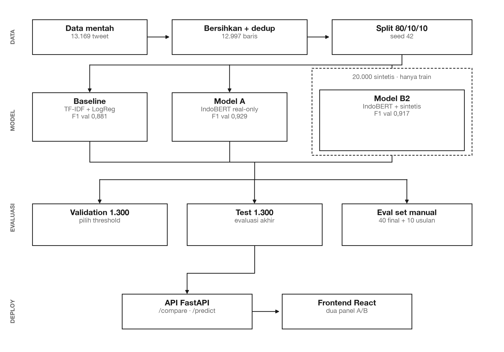
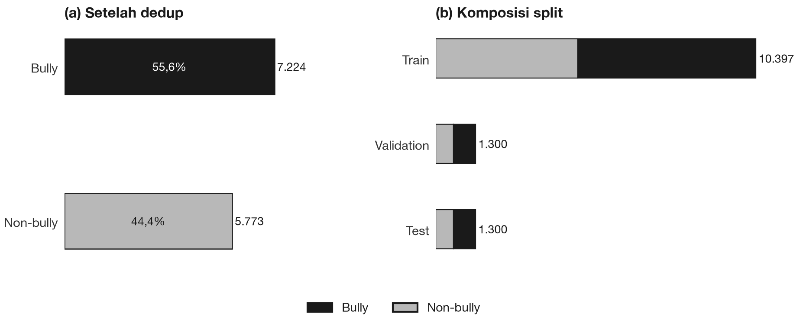
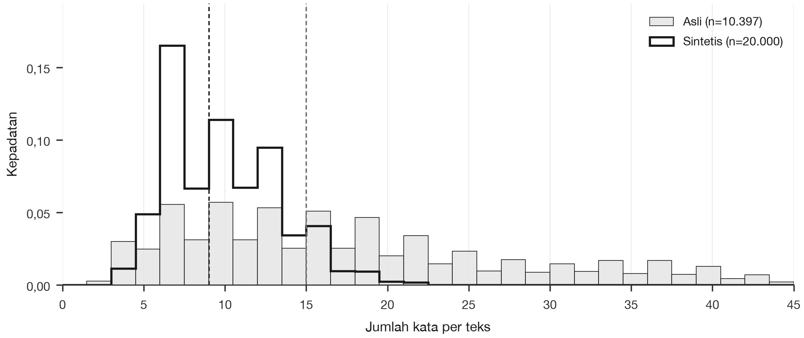
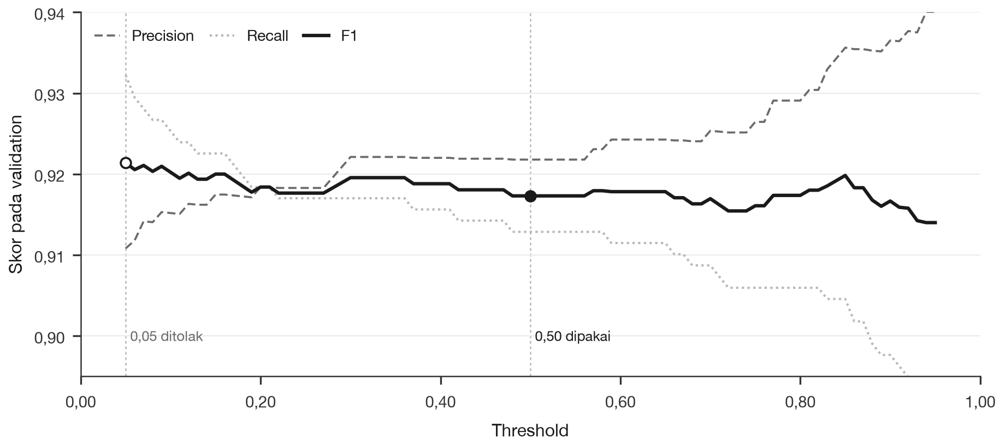
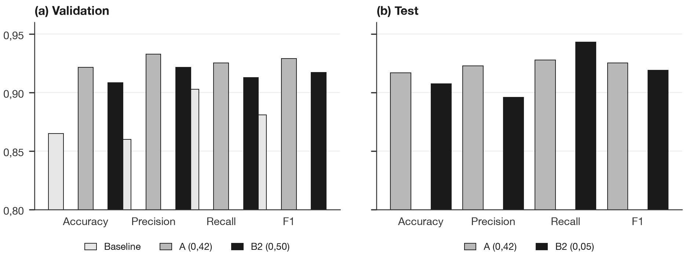

# Abstrak

Penelitian ini membandingkan tiga pendekatan untuk mendeteksi cyberbullying pada teks bahasa Indonesia: baseline TF-IDF dengan Logistic Regression, IndoBERT yang dilatih hanya pada data asli, dan IndoBERT yang dilatih pada data asli ditambah 20.000 contoh sintetis. Data asli berisi 13.169 tweet berlabel ujaran kebencian dan bahasa kasar; setelah deduplikasi tersisa 12.997 baris. Masalah utamanya bukan kata kasar, melainkan sindiran dan merendahkan tanpa kata kasar. Baseline mencapai F1 kelas bully 0,881 pada validation. Model real-only mencapai 0,926 pada threshold 0,5 dan 0,929 pada 0,42. Model dengan data sintetis memperoleh 0,917 pada 0,5, lebih rendah secara agregat, tetapi pada eval set manual 40 baris final F1-nya 0,897 dibanding 0,412 untuk model real-only. Model sintetis mendeteksi pujian menyindir, sarkasme karya, subtweet, dan body shaming, dengan konsekuensi lebih banyak false positive (teks aman yang ditandai bully) pada kritik dan teks netral. Hasil ini menunjukkan bahwa metrik agregat menyembunyikan trade-off yang penting.

# 1. Pendahuluan

Cyberbullying di media sosial tidak selalu berbentuk hinaan langsung. Banyak komentar menyerang lewat pujian yang menyindir, meremehkan karya, menyalahkan korban dengan alasan bercanda, atau membicarakan seseorang tanpa menyebut nama. Model yang hanya belajar kata kasar akan melewatkan komentar seperti itu, sekalipun akurasinya tinggi pada data uji biasa.

Penelitian ini mengajukan tiga pertanyaan. Pertama, seberapa baik IndoBERT dibanding baseline sederhana pada klasifikasi bully dan non-bully. Kedua, apakah contoh sintetis untuk sindiran non-kasar memperbaiki deteksi pada kategori yang sulit. Ketiga, apa konsekuensinya terhadap precision dan false positive.

Kontribusi yang disajikan adalah pipeline data yang dapat diulang, perbandingan model dengan split yang sama, evaluasi per kategori, serta implementasi API dan frontend yang menampilkan dua model secara berdampingan. Fokus penelitian ada pada komparasi model NLP, bukan pada penambahan arsitektur baru.

# 2. Data dan pipeline

## 2.1 Dataset

Dataset yang dipakai adalah *Indonesian Abusive and Hate Speech Twitter Text* dari Ibrohim dan Budi (2019). File berisi 13.169 tweet berbahasa Indonesia dengan 13 kolom. Dua kolom yang dipakai adalah `HS` untuk ujaran kebencian dan `Abusive` untuk bahasa kasar. Lisensinya CC BY-NC-SA 4.0: wajib atribusi, non-komersial, dan share-alike.

Label proyek didefinisikan sebagai gabungan:

$$
y_{\text{bully}} = \mathbb{1}\left(\text{HS}=1 \;\lor\; \text{Abusive}=1\right)
$$

Dengan definisi itu, data mentah memiliki 7.309 contoh bully dan 5.860 non-bully. Setelah normalisasi dan deduplikasi, tersisa 12.997 baris dengan 7.224 bully dan 5.773 non-bully. Dataset cukup seimbang, sehingga accuracy masih bisa dibaca, tetapi F1 kelas bully tetap menjadi metrik utama.

Table: **Tabel 1.** Ringkasan data asli setelah pembersihan.

| Tahap | Baris | Bully | Non-bully |
|---|---:|---:|---:|
| Data mentah | 13.169 | 7.309 | 5.860 |
| Setelah normalisasi dan dedup | 12.997 | 7.224 | 5.773 |
| Train | 10.397 | 5.779 | 4.618 |
| Validation | 1.300 | 723 | 577 |
| Test | 1.300 | 722 | 578 |

## 2.2 Pembersihan dan split

File asli bukan UTF-8 murni. Ada 953 karakter rusak dan 1.435 baris yang menyimpan emoji sebagai escape literal seperti `\xf0\x9f...`. Pipeline melakukan NFKC, casefold, perbaikan escape, penyamaran URL dan mention, serta pembersihan spasi. Stopword, emoji, dan tanda baca tidak dibuang karena dapat membawa sinyal sarkasme.

Deduplikasi dilakukan setelah normalisasi dan sebelum split. Aturan ini penting untuk mencegah kebocoran data (*data leakage*): jika teks yang sama muncul di train dan test, skor test menjadi terlalu optimistis. Model bisa menghafal kalimat yang pernah dilihatnya, bukan belajar pola. Split memakai stratifikasi 80/10/10 (proporsi bully dan non-bully dijaga sama di tiap bagian) dan seed 42 (agar hasil dapat diulang).

{width=6.4in}

{width=6.4in}

# 3. Baseline TF-IDF

Baseline memakai TF-IDF 1–2 gram dan Logistic Regression dengan bobot kelas seimbang. TF-IDF mengubah teks menjadi vektor frekuensi kata dan pasangan kata; Logistic Regression lalu menarik garis pemisah linear antara kedua kelas. Baseline bukan model yang diharapkan menang. Fungsinya memastikan bahwa masalahnya memang membutuhkan model bahasa, bukan hanya model linear.

Pemilihan nilai regularisasi dan threshold dilakukan pada validation. Baseline mencapai accuracy 0,865, precision bully 0,860, recall bully 0,903, dan F1 bully 0,881 pada threshold 0,40. Angka ini cukup kuat, sehingga peningkatan IndoBERT harus dinilai dengan hati-hati.

# 4. Model A: IndoBERT real-only

Model A memakai `indobenchmark/indobert-base-p1`, model bahasa Indonesia yang sudah dilatih pada korpus besar lalu disesuaikan pada tugas klasifikasi. Proses ini disebut fine-tuning. Konfigurasinya 3 epoch, batch size 16, panjang maksimum 128 token, learning rate $2\times10^{-5}$, pembobotan kelas (class weights), dan seed 42.

Epoch adalah jumlah putaran membaca seluruh data train; batch size adalah jumlah contoh per langkah; token adalah potongan kata yang menjadi input model. Data train hanya 10.397 komentar asli. Training dijalankan di GPU CUDA melalui Colab; konfigurasi tersimpan di `run_meta.json`.

Evaluasi validation memakai metrik:

$$
P=\frac{TP}{TP+FP},\qquad
R=\frac{TP}{TP+FN},\qquad
F_1=\frac{2PR}{P+R}
$$

Precision mengukur proporsi tuduhan bully yang benar; recall mengukur proporsi bully yang berhasil ditangkap; F1 menyeimbangkan keduanya. Pada threshold 0,5, model A memperoleh accuracy 0,918, precision 0,934, recall 0,918, dan F1 0,926. Threshold 0,42 memberi F1 0,929. Perbedaan 0,003 terlalu kecil untuk disebut peningkatan berarti. Threshold 0,42 dipilih karena memberi F1 tertinggi pada validation, bukan karena test.

# 5. Data sintetis untuk sindiran non-kasar

Model yang hanya melihat data asli gagal pada empat dari lima contoh sulit dalam uji manual awal: pujian menyindir, sarkasme karya, gaslighting, dan body shaming. Subtweet justru tertangkap. Karena itu dibuat 20.000 contoh sintetis yang hanya dipakai untuk train.

Table: **Tabel 2.** Komposisi data sintetis. Label 1 berarti bully dan 0 berarti aman; hard negative adalah contoh aman yang permukaannya mirip sindiran.

| Kategori | Label | Jumlah |
|---|---:|---:|
| Sindiran inti | 1 | 3.000 |
| Merendahkan | 1 | 2.000 |
| Satir | 1 | 1.000 |
| Pujian menyindir | 1 | 2.000 |
| Sarkasme karya | 1 | 2.000 |
| Gaslighting | 1 | 1.500 |
| Subtweet | 1 | 1.500 |
| Body shaming | 1 | 1.000 |
| Kritik membangun | 0 | 1.500 |
| Pujian tulus | 0 | 1.000 |
| Permintaan maaf tulus | 0 | 1.000 |
| Netral | 0 | 1.000 |
| Becanda akrab | 0 | 1.000 |
| Perhatian tulus | 0 | 500 |

Totalnya 14.000 positif dan 6.000 hard negative. Hard negative sengaja dimasukkan agar model tidak belajar bahwa semua sindiran adalah bully. Frasa “cuma bercanda” tidak dipakai sebagai contoh becanda akrab yang aman; frasa itu hanya muncul pada konteks gaslighting atau permintaan maaf yang benar-benar tulus.

Data sintetis dibuat dari pola dan slot, bukan 20.000 kalimat tulisan manusia independen. Pemeriksaan otomatis memastikan tidak ada duplikat, PII, URL, akun, atau overlap teks dengan train, validation, test, dan eval set. Median panjangnya 9 kata, lebih pendek daripada data asli yang mediannya 15 kata.

{width=6.0in}

# 6. Model B2: IndoBERT dengan data sintetis

Model ini disebut B2 karena versi B pertama sudah dihapus setelah gagal pada beberapa kategori sindiran; angka versi itu tidak dipakai. Model B2 memakai arsitektur dan hyperparameter yang sama dengan A, tetapi data train bertambah menjadi 30.397 baris: 10.397 asli dan 20.000 sintetis. Bobot kelas dihitung ulang karena komposisi train berubah. Validation dan test tidak berubah.

Pada threshold 0,5, B2 memperoleh accuracy 0,908, precision 0,922, recall 0,913, dan F1 0,917. Secara agregat B2 lebih rendah dari A. Namun angka agregat tidak menunjukkan perilaku pada kategori yang menjadi tujuan penelitian. Bagian berikut memisahkan validation, test, dan eval set manual agar perbedaan itu terlihat.

# 7. Protokol evaluasi

Validation dipakai untuk memilih model dan threshold. Test dipakai sekali untuk evaluasi akhir tiap model, tetapi test sudah pernah dipakai versi B sebelumnya; ini dibahas di Keterbatasan. Selain itu, dibuat eval set manual berisi kasus sulit. Eval set tidak dipakai untuk training atau memilih threshold.

Aturan keputusan threshold adalah:

$$
\hat{y}=\mathbb{1}\left[p_{\text{bully}}\ge\tau\right]
$$

Threshold adalah ambang probabilitas: teks dengan probabilitas bully di atas ambang disebut bully. Threshold dipilih dari validation. Jika F1 terbaik hanya menang kurang dari 0,002 dari 0,5, atau jika nilainya mentok di batas grid 0,05, sistem memakai 0,5. Aturan ini mencegah threshold rendah yang hanya merupakan artefak pencarian.

{width=6.0in}

# 8. Hasil

**Validation.** Tabel 3 membandingkan baseline, A, dan B2 pada validation. Model A memakai threshold 0,42; B2 memakai 0,5; baseline memakai 0,40. Semua threshold dipilih dari validation, bukan dari test.

Table: **Tabel 3.** Hasil validation (n=1.300). F1 adalah F1 kelas bully.

| Model | Threshold | Accuracy | Precision | Recall | F1 |
|---|---:|---:|---:|---:|---:|
| Baseline TF-IDF | 0,40 | 0,865 | 0,860 | 0,903 | 0,881 |
| A real-only | 0,42 | 0,922 | 0,933 | 0,925 | 0,929 |
| B2 real+sintetis | 0,50 | 0,908 | 0,922 | 0,913 | 0,917 |

**Test.** Tabel 4 menunjukkan hasil test. Model A diuji pada 0,42. Model B2 diuji pada 0,05, sebelum kebijakan threshold diperbaiki. Threshold deploy B2 sekarang 0,5, tetapi angka test pada 0,5 belum ada dan tidak dibuat ulang agar tidak menjadi evaluasi kedua. Perbandingan test ini karena itu tidak sepenuhnya sebanding.

Table: **Tabel 4.** Hasil test (n=1.300) dengan catatan perbedaan threshold.

| Model | Threshold | Accuracy | Precision | Recall | F1 |
|---|---:|---:|---:|---:|---:|
| A real-only | 0,42 | 0,917 | 0,923 | 0,928 | 0,925 |
| B2 real+sintetis | 0,05 | 0,908 | 0,896 | 0,943 | 0,919 |

{width=6.4in}

**Eval set manual.** Eval set berisi 50 baris; 40 sudah final dan 10 masih usulan. Gaslighting belum masuk hitungan karena semua barisnya masih usulan. Tabel 5 menunjukkan hasil pada 40 baris final.

Table: **Tabel 5.** Hasil eval set manual pada 40 baris final.

| Model | Accuracy | Precision bully | Recall bully | F1 bully |
|---|---:|---:|---:|---:|
| A real-only | 0,500 | 1,000 | 0,259 | 0,412 |
| B2 real+sintetis | 0,850 | 0,839 | 0,963 | 0,897 |

{width=6.2in}

B2 mendeteksi pujian menyindir, body shaming, sarkasme karya, sindiran, dan subtweet dengan akurasi 1,0. A gagal total di pujian menyindir, body shaming, sarkasme karya, dan sindiran; pada subtweet A hanya benar 2 dari 6 baris. Sebaliknya, B2 menurun pada kritik (0,40) dan opini (0 dari 1 baris). A tetap bersih pada kritik, netral, dan keluhan karena model ini sangat konservatif.

Angka per kategori harus dibaca dengan ukuran sampelnya. Sarkasme karya, opini, dan keluhan hanya punya satu baris final, sehingga akurasi 0 atau 1 pada kategori itu tidak stabil. Kategori dengan bukti lebih kuat adalah pujian menyindir (5 baris), body shaming (5), kritik (5), netral (6), dan subtweet (6).

Secara kualitatif, B2 menandai kelima contoh sulit yang diuji dengan probabilitas sekitar 1,0, sedangkan A melewatkan empat di antaranya. Contoh-contoh ini tidak dipakai sebagai angka evaluasi; statusnya ilustrasi, bukan bukti statistik.

# 9. Pembahasan

Temuan utama bukan “B2 lebih baik” secara umum, melainkan bahwa B2 memindahkan jenis kesalahan. Model real-only sangat konservatif: hampir tidak pernah menuduh teks aman sebagai bully, tetapi melewatkan sebagian besar sindiran. Model sintetis lebih berani menandai sindiran, dengan risiko false positive pada kritik dan percakapan netral.

Threshold 0,05 pada B2 adalah contoh bagaimana pemilihan otomatis bisa menyesatkan. Pada validation, F1 di 0,05 hanya 0,004 lebih tinggi dari 0,5, tetapi precision turun dan operating point menjadi tidak wajar. Untuk alat moderasi, keputusan threshold sebaiknya mempertimbangkan biaya false positive, bukan hanya F1 maksimum. Kebijakan yang dipakai sekarang menolak titik di batas grid dan memakai 0,5.

Eval set juga menunjukkan batas klaim. Empat puluh baris terlalu kecil untuk kesimpulan umum, gaslighting belum terukur, dan contoh sintetis dibuat dari pola yang bisa bias. Dataset asli tidak secara eksplisit mendefinisikan cyberbullying; labelnya adalah ujaran kebencian dan bahasa kasar. Model juga tidak membaca konteks percakapan, hubungan antar pengguna, atau nada bicara.

# 10. API

API FastAPI memuat dua model sekali saat startup. Endpoint yang dipakai:

- `GET /health` mengembalikan status model dan threshold A/B.
- `POST /predict?model=a|b` mengembalikan label, skor, probabilitas bully, dan threshold.
- `POST /compare` mengembalikan hasil A dan B sekaligus.
- Input kosong atau lebih dari 2.000 karakter menghasilkan 422.
- Model belum lengkap menghasilkan 503, bukan crash.

Threshold dibaca dari `threshold.json` di folder model. Ini memastikan label API sama dengan evaluasi, bukan memakai 0,5 default. CORS dibatasi ke origin frontend pengembangan.

# 11. Frontend

Frontend Vite dan React menampilkan satu input dengan dua panel hasil. Pengguna dapat membandingkan Model A dan Model B2 pada teks yang sama, termasuk probabilitas, threshold, dan selisih. Antarmuka memakai Geist Sans dan Geist Mono, warna monokrom, sidebar desktop, drawer mobile, serta mode terang dan gelap. Tampilan ini bukan bagian dari klaim performa; ia hanya membuat perbedaan model dapat diperiksa secara langsung.

{width=6.2in}

# 12. Keterbatasan dan etika

Pertama, data sintetis dibuat dari template. Model bisa menghafal pola generator, bukan belajar sindiran yang benar-benar baru. Kedua, eval set final baru 40 baris dan gaslighting belum masuk. Ketiga, test sudah dipakai oleh A dan B2 versi sebelumnya, sehingga bukan lagi test yang sepenuhnya perawan. Keempat, dataset asli tidak memiliki konteks percakapan, hubungan antar pengguna, atau definisi cyberbullying yang eksplisit. Kelima, hasil berasal dari satu split; belum ada confidence interval atau pengujian statistik.

Dari sisi etika, model ini alat bantu moderasi, bukan alat penghukuman otomatis. False positive pada kritik, becanda akrab, dan bahasa kasar antarteman tetap mungkin. Dataset berlisensi non-komersial dan wajib diatribusikan. Teks pengguna tidak boleh dipublikasikan tanpa izin, dan keputusan moderasi harus tetap melibatkan manusia.

# 13. Kesimpulan

IndoBERT mengungguli baseline pada validation, tetapi keunggulan itu tidak cukup untuk menyimpulkan bahwa model memahami sindiran. Model real-only tetap konservatif pada eval set, sedangkan model dengan data sintetis jauh lebih baik pada sindiran non-kasar dengan harga precision yang lebih rendah. Untuk tujuan penelitian ini, B2 lebih relevan sebagai kandidat deteksi sindiran, tetapi A tetap lebih aman untuk menjaga false positive. Keputusan akhir bergantung pada biaya kesalahan yang dipilih, dan itu harus dilaporkan sebagai trade-off, bukan sebagai satu skor tunggal.

Langkah berikutnya adalah menambah eval set final sampai minimal 200 baris, memfinalkan kategori gaslighting, dan menguji apakah keunggulan B2 bertahan pada data baru di luar template sintetis.

# Referensi

Ibrohim, M. O., dan Budi, I. (2019). Multi-label Hate Speech and Abusive Language Detection in Indonesian Twitter. *Proceedings of the Third Workshop on Abusive Language Online (ALW3)*, 46–57.

Devlin, J., Chang, M.-W., Lee, K., dan Toutanova, K. (2019). BERT: Pre-training of Deep Bidirectional Transformers for Language Understanding. *NAACL-HLT*.

Wilie, B., dkk. (2020). IndoNLU: Benchmark and Resources for Evaluating Indonesian Natural Language Understanding. *AACL-IJCNLP*.

# Lampiran

Repositori: <https://github.com/Rbooii/CyberBully-Detection>

Perintah utama:

```bash
python -m cyberbully.data --input data/raw/re_dataset.csv \
  --text-col Tweet --label-col HS Abusive --positive 1 \
  --label-mode any --keep-cols HS Abusive

python scripts/generate_synthetic.py
python scripts/check_synthetic.py
python scripts/augment_train.py

python -m cyberbully.train --train-file data/processed/train_augmented.csv \
  --out models/indobert_aug

python -m cyberbully.evaluate --model-dir models/indobert_aug \
  --split val --implicit-eval data/eval/implicit_eval.csv --out-dir out/model_b
```

Artefak penting: `models/indobert_real`, `models/indobert_aug`, `out/model_a`, `out/model_b`, dan `docs/figures`. Laporan ini dibangun ulang dengan `python scripts/build_report.py`.
